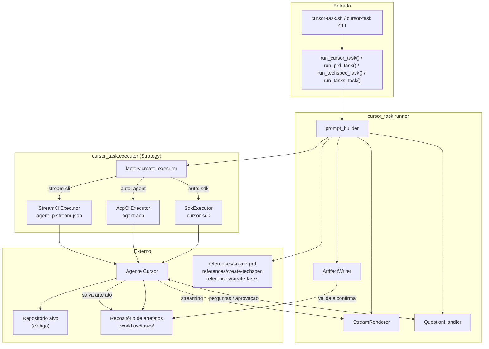
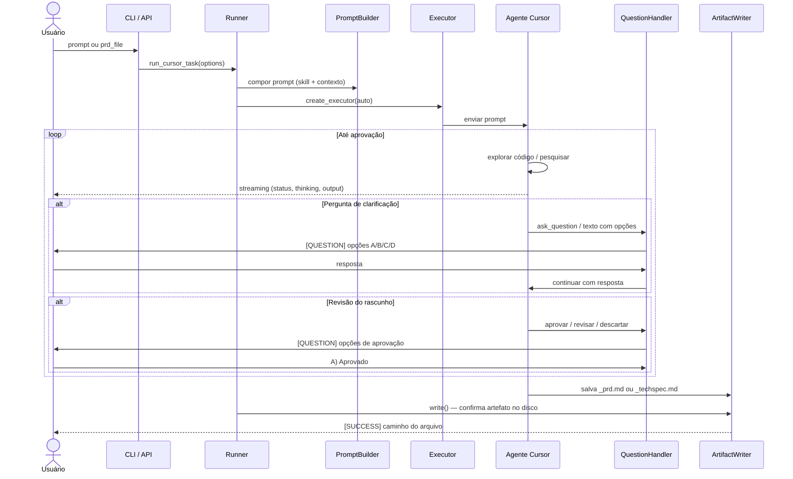
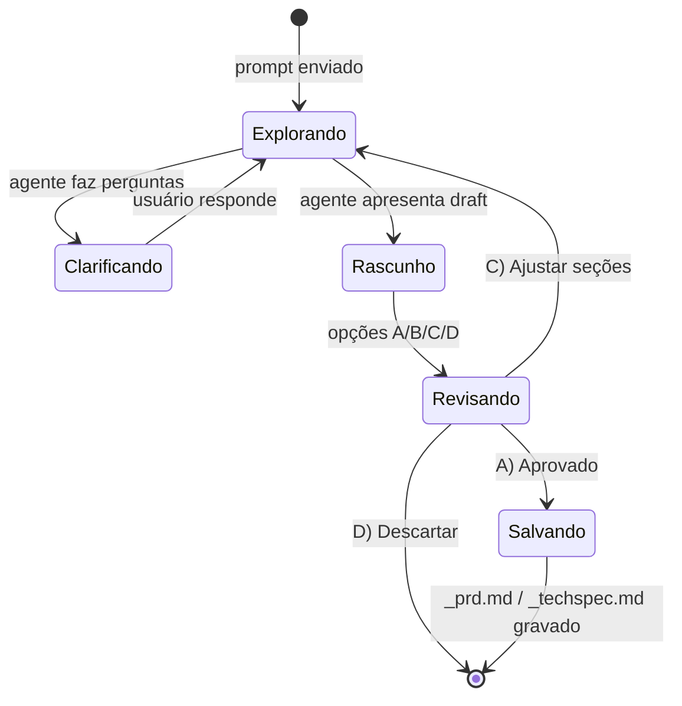

# pulse-cursor-task

CLI e biblioteca Python para executar tarefas interativas com agentes Cursor, gerando artefatos de produto (PRD) e engenharia (TechSpec) a partir de skills estruturadas.

## Visão geral

O projeto orquestra conversas com agentes de IA do Cursor para produzir documentação estruturada em dois fluxos:

| Fluxo | Entrada | Saída |
|-------|---------|-------|
| **PRD** | Prompt do usuário + skill `create-prd` | `.workflow/tasks/<slug>/_prd.md` |
| **TechSpec** | Caminho do PRD + skill `create-techspec` | `.workflow/tasks/<slug>/_techspec.md` |
| **Tasks** | Caminho do TechSpec + skill `create-tasks` | `.workflow/tasks/<slug>/_tasks.md` + `task_NN.md` |

Dois repositórios participam de cada execução:

- **Repositório alvo** (`project_path`) — código-fonte explorado pelo agente para contexto técnico.
- **Repositório de artefatos** (`artifacts_path`) — onde PRDs, TechSpecs e ADRs são salvos (por padrão, este repositório).

## Diagrama de arquitetura



## Fluxo de execução



## Estrutura do projeto

```
pulse.ia-backend/
├── cursor_task/              # Pacote Python principal
│   ├── cli.py                # Interface de linha de comando
│   ├── runner.py             # Orquestração dos fluxos PRD/TechSpec
│   ├── prompt_builder.py     # Montagem de prompts com skills
│   ├── question_handler.py   # Perguntas interativas e aprovação
│   ├── artifact_writer.py    # Detecção e gravação de artefatos
│   ├── stream_renderer.py    # Saída formatada no terminal
│   └── executor/
│       ├── factory.py        # Seleção automática do executor
│       ├── sdk_executor.py   # Via cursor-sdk (preferencial)
│       ├── acp_executor.py   # Via Cursor CLI (protocolo ACP)
│       ├── stream_cli_executor.py  # Via Cursor CLI (stream-json)
│       └── completion.py     # Lógica de aprovação pós-rascunho
├── references /              # Skills e templates
│   ├── create-prd/           # Skill de geração de PRD
│   ├── create-techspec/      # Skill de geração de TechSpec
│   └── create-tasks/         # Skill de decomposição em tasks
├── .workflow/tasks/          # Artefatos gerados por tarefa
│   └── <slug>/
│       ├── _prd.md
│       ├── _techspec.md
│       ├── _tasks.md
│       ├── task_01.md
│       └── adrs/
├── cursor-task.sh            # Wrapper com venv
└── tests/
```

## Componentes principais

### Runner (`runner.py`)

Ponto central que valida caminhos, compõe o prompt, instancia executor e garante que o artefato só é finalizado após aprovação explícita do usuário.

### Prompt Builder (`prompt_builder.py`)

Combina a skill referenciada (`@references /create-prd/SKILL.md`) com instruções do usuário e metadados de caminhos. No fluxo TechSpec, injeta o caminho do PRD, diretório de ADRs e regras de clarificação técnica.

### Executores (`executor/`)

Contrato `AgentProvider` com três implementações Cursor intercambiáveis, selecionadas por `factory.create_executor`:

| Executor | Quando usar | Dependência |
|----------|-------------|-------------|
| `SdkExecutor` | Padrão em `auto` | `cursor-sdk` + `CURSOR_API_KEY` |
| `AcpCliExecutor` | Fallback ou `--executor acp` | Binário `agent` |
| `StreamCliExecutor` | `--executor stream-cli` | Binário `agent` |

### Question Handler (`question_handler.py`)

Detecta perguntas do agente (via tool calls, protocolo ACP ou texto com opções A–D), exibe no terminal e captura respostas. Controla o ciclo de aprovação do rascunho antes da gravação final.

### Artifact Writer (`artifact_writer.py`)

Localiza artefatos em `.workflow/tasks/**/*_prd.md` ou `*_techspec.md` criados durante a sessão e confirma a gravação no disco após aprovação.

## Skills e artefatos

As skills em `references /` definem o comportamento do agente:

- **create-prd** — brainstorming interativo, pesquisa de código e mercado, ADRs de abordagem, rascunho e revisão antes de salvar `_prd.md`.
- **create-techspec** — leitura do PRD, perguntas técnicas (3–6), ADRs de decisão, rascunho e revisão antes de salvar `_techspec.md`.
- **create-tasks** — leitura do TechSpec (e PRD quando disponível), decomposição em tasks, aprovação do breakdown, geração de `_tasks.md` e enriquecimento de `task_NN.md`.

Cada tarefa usa um slug derivado do nome da feature:

```
.workflow/tasks/<slug>/
├── _prd.md          # Product Requirements Document
├── _techspec.md     # Especificação técnica
├── _tasks.md        # Lista mestre de tasks
├── task_01.md       # Task individual enriquecida
└── adrs/
    ├── adr-001.md
    └── ...
```

## Uso

### Instalação

```bash
python3 -m venv .venv
.venv/bin/pip install -e ".[dev]"
export CURSOR_API_KEY="sua-chave"
```

### Gerar PRD

```bash
./cursor-task.sh prd "Criar feature de logs e monitoramento de saúde"
```

### Gerar TechSpec a partir de PRD

```bash
./cursor-task.sh techspec .workflow/tasks/logs-monitoramento-saude-aplicacao/_prd.md
```

### Gerar Tasks a partir de TechSpec

```bash
./cursor-task.sh tasks .workflow/tasks/logs-monitoramento-saude-aplicacao/_techspec.md
```

### Opções avançadas

```bash
./cursor-task.sh prd "Minha feature" /caminho/do/projeto-alvo \
  --output-file .workflow/tasks/minha-feature/_prd.md \
  --executor auto \
  --model composer-2.5
```

### Uso como biblioteca

```python
from cursor_task import run_prd_task, run_tasks_task, run_techspec_task

result = run_prd_task("Criar feature de autenticação OAuth")
print(result.output_file)

result = run_techspec_task(".workflow/tasks/oauth/_prd.md")
print(result.artifact_content)

result = run_tasks_task(".workflow/tasks/oauth/_techspec.md")
print(result.output_file)
```

## Ciclo de aprovação

O sistema impõe que o agente **não salve o artefato final** até o usuário aprovar o rascunho:



A lógica em `completion.py` garante que, se o agente salvar cedo demais, um follow-up prompt exige revisão; se o usuário aprovar mas o arquivo não existir, um follow-up pede a gravação.

## Testes

```bash
.venv/bin/pytest tests/
```
